<a href="https://ouss.es">
  <picture>
    <source media="(prefers-color-scheme: dark)" srcset="assets/header-dark.svg" />
    
  </picture>
</a>

 

<a href="https://to.ouss.es/writings">
  <picture>
    <source media="(prefers-color-scheme: dark)" srcset="assets/label-writings-dark.svg" />
    
  </picture>
</a>

<!-- writings:start -->
&ensp;[A business card in your terminal](https://ouss.es/p/blog/npx-ouss/ "How a one-file npm package became my business card, and why the name it holds matters more than the code.")&ensp;*20 July 2025*\
&ensp;[String manipulation](https://ouss.es/p/blog/string-manipulation/ "A beginner-friendly tutorial on everything about strings in Pawn, from declaring them to format specifiers.")&ensp;*29 May 2018*\
&ensp;[All 4 posts](https://to.ouss.es/posts), or follow them [by RSS](https://to.ouss.es/rss).
<!-- writings:end -->

<a href="https://to.ouss.es/whereabouts">
  <picture>
    <source media="(prefers-color-scheme: dark)" srcset="assets/label-whereabouts-dark.svg" />
    
  </picture>
</a>

&ensp;[ouss.es](https://ouss.es), my portfolio.\
&ensp;[to.ouss.es/in](https://to.ouss.es/in), my work history.\
&ensp;[Behance](https://to.ouss.es/behance), [Dribbble](https://to.ouss.es/dribbble) and [Figma](https://to.ouss.es/figma), my design work.\
&ensp;Read [my CV](https://to.ouss.es/cv) or [download it](https://to.ouss.es/resume), and [catch up](https://to.ouss.es/now) with me.\
&ensp;[Write to me](https://to.ouss.es/mail) at hi@ouss.es.\
&ensp;[Sponsor me on GitHub](https://to.ouss.es/sponsor) or [tip me through PayPal](https://to.ouss.es/tip).

  <a href="https://ouss.es">
    <picture>
      <source media="(prefers-color-scheme: dark)" srcset="assets/signature-dark.svg" />
      
    </picture>
  </a>
   
  © 2026 Oussama Essamadi

