<a href="https://ouss.es">
  <picture>
    <source media="(prefers-color-scheme: dark)" srcset="assets/header-dark.svg" />
    
  </picture>
</a>

 

<a href="https://ouss.es/#writings">
  <picture>
    <source media="(prefers-color-scheme: dark)" srcset="assets/label-writings-dark.svg" />
    
  </picture>
</a>

<!-- writings:start -->
&ensp;[A business card in your terminal](https://ouss.es/p/blog/npx-ouss/ "How a one-file npm package became my business card, and why the name it holds matters more than the code.")&ensp;*20 July 2025*\
&ensp;[String manipulation](https://ouss.es/p/blog/string-manipulation/ "A beginner-friendly tutorial on everything about strings in Pawn, from declaring them to format specifiers.")&ensp;*29 May 2018*\
&ensp;[All 4 posts](https://ouss.es/?list=posts), or follow them [by RSS](https://ouss.es/p/rss.xml).
<!-- writings:end -->

<a href="https://ouss.es/#whereabouts">
  <picture>
    <source media="(prefers-color-scheme: dark)" srcset="assets/label-whereabouts-dark.svg" />
    
  </picture>
</a>

&ensp;[ouss.es](https://ouss.es), my portfolio.\
&ensp;[linkedin.com/in/eoussama](https://www.linkedin.com/in/eoussama), my work history.\
&ensp;[Behance](https://www.behance.net/eoussama), [Dribbble](https://dribbble.com/EOussama) and [Figma](https://www.figma.com/@eoussama), my design work.\
&ensp;Read [my CV](https://ouss.es/p/cv/) or [download it](https://ouss.es/p/resume.pdf), and [catch up](https://ouss.es/p/now/) with me.\
&ensp;[Write to me](mailto:oussama.essamadi@gmail.com) at oussama.essamadi@gmail.com.\
&ensp;[Sponsor me on GitHub](https://github.com/sponsors/eoussama) or [tip me through PayPal](https://paypal.me/OussamaEssamadi).

  <a href="https://ouss.es">
    <picture>
      <source media="(prefers-color-scheme: dark)" srcset="assets/signature-dark.svg" />
      
    </picture>
  </a>
   
  © 2026 Oussama Essamadi

